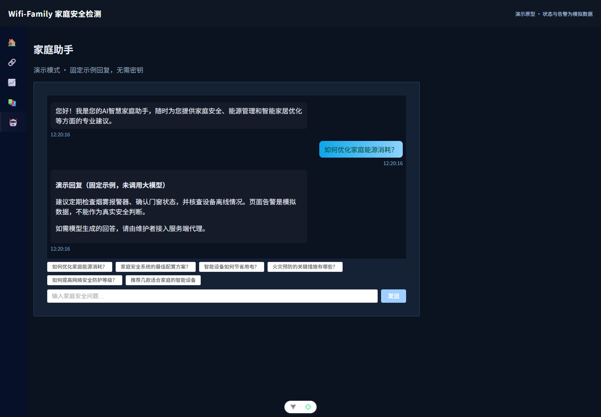

# Wifi-Family-Demo 家庭安全检测展示版

面向家庭安全场景的 Web 界面原型，包含状态总览、模拟告警、数据可视化、日志和聊天助手。使用 Vue 3、Vite、Element Plus 与 ECharts，代码开发过程中使用了 AI 辅助。

**当前展示数据为模拟数据。** 此仓库不包含完整设备后端、真实火灾/入侵识别模型，也未实现 Agent 工作流、工具调用或 RAG。请勿用作真实安防或紧急报警系统。

## 与原项目的关系

本仓库源于 **2025.09—2025.11 的家庭安全检测系统 Web 原型**，原项目已取得软件著作权登记，证书与申报材料不包含在展示仓库。这是 **2026-10-24 起整理的独立展示版本**，使用新的 Git 历史；旧开发仓库继续保留私有。这里的创建时间与提交记录对应展示整理，不代表原项目的开发时间。

当前项目主要是面向未来后端设备接入设计的前端界面，包含已实现的聊天助手交互。默认状态、图表和告警使用模拟数据；聊天默认固定演示回复，真实模型接入需要自行提供服务端代理。设备 API 是预留约定，仓库未提供完整设备后端。

2026 年新增的聊天安全与可靠性修复、界面提示和文档整理单独记录在 [展示版更新说明](docs/展示版更新说明.md)，不计入 2025 年成果。本仓库不包含旧 Git 历史、私人配置或软件著作权申报材料。请按 `.env.example` 自行配置环境，不要在前端提供真实 API 密钥。

## 本地运行

Node.js `^20.19.0` 或 `>=22.12.0`，在项目根目录执行：

```sh
npm ci
npm run dev -- --host 127.0.0.1 --port 5175
```

访问 <http://127.0.0.1:5175>。默认聊天返回明确标注的固定演示回复，无需 API 密钥或模型账号。若端口被占用，以终端显示的地址为准。

```sh
npm run build
npm run preview -- --host 127.0.0.1 --port 4173
node --test tests/chatStream.test.js
```

预览访问 <http://127.0.0.1:4173>。生产环境使用 history 路由，需将未知页面路径回退到 `index.html`；当前未提供在线演示地址。

## 可以体验什么

| 页面 | 当前行为 | 边界 |
| --- | --- | --- |
| 总览 | 展示安全状态、检测模式与告警交互 | 随机模拟告警，不代表传感器检测 |
| 数据可视化 | 展示 CSI、火焰/烟雾等图表效果 | 随机数据，不证明模型已运行 |
| 系统日志 | 事件展示与筛选 | 前端演示状态，不是服务端审计系统 |
| 家庭助手 | 消息、快捷提问、安全 Markdown 与错误提示 | 默认固定回复，非模型生成 |
| 设备连接 | 配置表单、连接状态与振幅预览入口 | 默认禁用连接，需自行提供后端 |



## 聊天实现与配置

页面调用链为 `SimpleAiAssistant.vue` / `AIAssistant.vue` → `useAiChat.js` → `chatStream.js`。`src/utils/aiService.js` 是历史备用实现，当前聊天页面没有调用它。

2025 年版本在 `useAiChat.js` 中直接请求 SiliconFlow 的对话接口，使用 `Qwen/QwQ-32B`，通过 Fetch 读取流式返回并使用 marked 展示 Markdown。2026 年整理版默认改为本地演示，增加跨网络分片缓冲、超时、重复提交保护和 DOMPurify 清理。

需要接入真实模型时，复制 `.env.example` 为 `.env.local`，设置：

```dotenv
VITE_CHAT_MODE=proxy
VITE_CHAT_PROXY_PATH=/api/chat
```

必须自行实现同源服务端代理。本仓库**没有提供该服务端**。前端发送 `{ messages: [{ role: "user", content: "..." }], stream: true }`；代理应返回 `Content-Type: text/event-stream`，事件遵循 `data: {"choices":[{"delta":{"content":"文字"}}]}`，以 `data: [DONE]` 结束。当前只发送本次问题，没有多轮上下文记忆。代理应在服务端管理密钥、鉴权、限流及提示词。

**`VITE_*` 变量会进入浏览器构建产物，不能保护 API 密钥。** 不要在前端、`.env.example`、截图或提交记录中填入真实密钥。旧的 `VITE_TRACK_FLOW_API_KEY` 等变量不再用于当前聊天入口；不要启用历史备用直连实现。

## 设备接入边界

`VITE_DEVICE_SERVER_URL` 为空时不自动连接 Socket.IO，设备页显示未接入，保存/重连按钮禁用。需自行提供以下后端约定后再设置服务地址：

- `GET /config`：读取 MQTT 配置。
- `POST /config`：保存 `MQTT_SERVER / MQTT_PORT / MQTT_TOPIC / DEVICE_MAC`。
- `POST /mqtt/reconnect`：请求重连。
- Socket.IO `csi_data`：数值数组，或 `{ amplitude: [...] }`。

配置跨源服务时还需处理 HTTPS、CORS、鉴权及配置权限。此预留接口尚未完成真实设备端到端验收，设备流也没有替代演示告警和随机图表。

## 版本与成果范围

- 原项目周期：2025.09—2025.11，已取得软件著作权登记；登记证书及申报材料不包含在展示仓库。
- 2026-10-24：为公开展示整理功能边界、启动说明及聊天安全性。这些新增改进不回写为 2025 年成果。

本展示仓库未新增开源许可证。公开展示不等于授予开源许可，使用和再分发前请联系权利人。

## 维护说明

`npm run lint` 会自动修改文件；只读检查可执行 `npx eslint src`。仓库存在历史代码规范问题，生产构建仍有包体积提示，未在本轮进行全局重构。

本展示仓库使用经过筛选的独立源文件发布。虚拟环境、私人配置、个人材料与生产数据不得提交；更新前请检查暂存区及构建产物。
